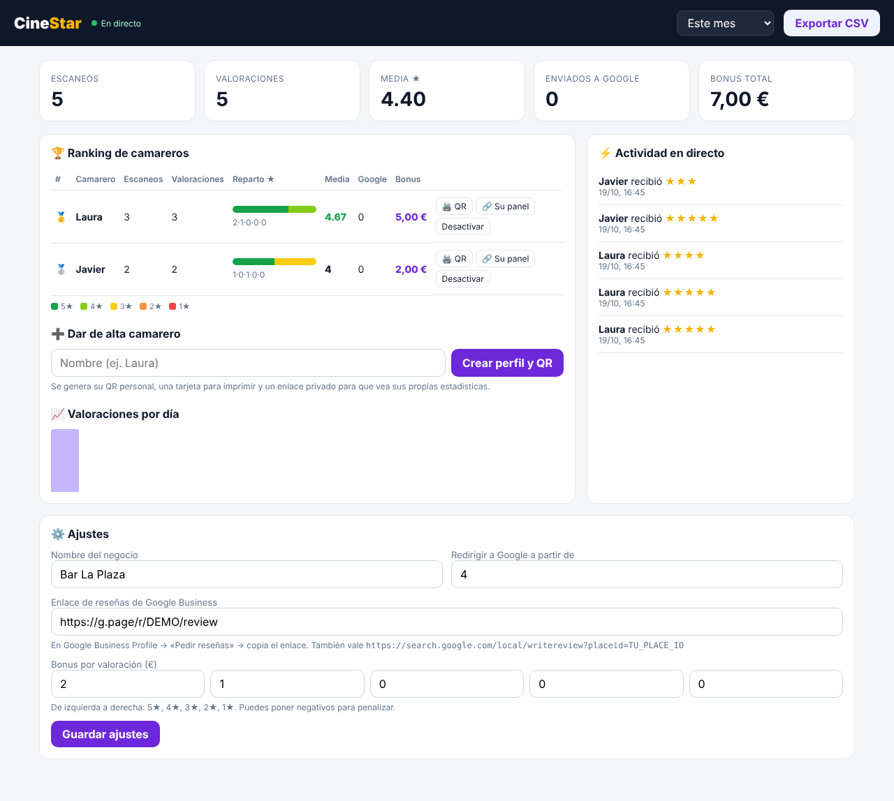

# TopReview

Cada camarero tiene su propio QR. El cliente lo escanea, valora la atención con 1–5 estrellas
y se le lleva a la ficha de **Google Business** para dejar la reseña. El dashboard muestra en
tiempo real el desempeño de cada camarero y calcula su bonus según las estrellas recibidas.



## Cómo funciona

1. **Alta del camarero** (dashboard → «Dar de alta camarero»): se crea su perfil, su QR y una tarjeta lista para imprimir.
2. **El cliente escanea** el QR → pantalla «¿Qué tal te ha atendido Laura?» con 5 estrellas.
3. **4–5★** → «¡Gracias! Menciona a Laura» y redirección automática a la reseña de Google.
   **1–3★** → se le pide un comentario privado para la dirección (y se le sigue ofreciendo el enlace a Google).
4. **Dashboard en directo**: escaneos, valoraciones, reparto 5/4/3/2/1★, media, clics a Google y bonus en €. Filtro hoy/semana/mes/todo y exportación CSV para nóminas.
5. **Panel del camarero**: cada uno tiene un enlace privado (`/me/…`) con su QR, su media y su bonus del mes.

## Arrancar en local

```bash
npm install
ADMIN_PASSWORD=una-clave-segura npm start
# Dashboard: http://localhost:3000/admin  (usuario: admin)
```

Requiere Node 22.5+ (usa la base de datos SQLite integrada en Node, sin servicios externos).

## Variables de entorno

| Variable | Para qué |
|---|---|
| `ADMIN_PASSWORD` | Contraseña del dashboard (**cámbiala**, por defecto `topreview`) |
| `ADMIN_USER` | Usuario del dashboard (por defecto `admin`) |
| `BASE_URL` | URL pública, p. ej. `https://topreview.tudominio.es` (es la que va dentro de los QR) |
| `DATA_DIR` | Carpeta de la base de datos (debe ser un disco persistente) |
| `PORT` | Puerto (por defecto 3000) |

## Publicarlo en internet

Cualquier hosting de Node con disco persistente sirve (Railway, Render, Fly.io, un VPS…):
start command `npm start`, monta un volumen en `DATA_DIR` y define `BASE_URL` **antes de imprimir los QR**.

## Enlace de reseñas de Google

Google Business Profile → «Pedir reseñas» → copia el enlace (`https://g.page/r/…/review`) y pégalo en **Ajustes**.

## Importante

- **Política de Google**: Google prohíbe filtrar reseñas (pedírselas solo a clientes contentos) y ofrecer
  incentivos *al cliente* por reseñar. Por eso todos los clientes tienen acceso al enlace de Google.
- **Las estrellas que cuentan para el bonus son las de TopReview**, no las de Google: Google no permite saber
  qué camarero originó cada reseña. «Enviados a Google» cuenta clics, no reseñas publicadas.
- **Antifraude básico**: un voto por dispositivo y camarero cada 12 h (si repite, se actualiza en vez de sumar).

## Publicar en Render (un clic)

1. Entra en <https://dashboard.render.com/blueprints> con tu cuenta de GitHub → **New Blueprint Instance** → elige este repositorio.
2. Render lee `render.yaml` y crea el servicio con disco persistente (plan Starter, unos 7 $/mes).
3. Al terminar, la contraseña del dashboard está en **Environment → ADMIN_PASSWORD**.
4. Copia la URL que te da Render (p. ej. `https://topreview.onrender.com`), añádela como variable `BASE_URL` y entonces imprime los QR.

`BUSINESS_NAME` y `GOOGLE_REVIEW_URL` solo se usan la primera vez; después se cambian desde **Ajustes** en el dashboard.
